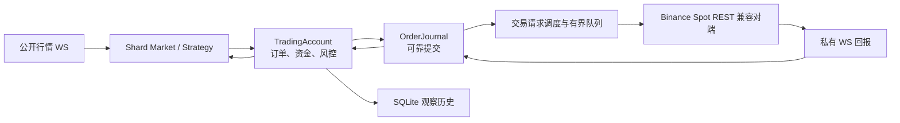

# 交易链路后续开发与验收记录

状态：可靠日志、重启与断线对账、账户风控、规则查询、请求调度和运行控制已接入 `external_sim`。本机真实 socket、故障注入和持续运行回归已通过；`live` 仍由配置拒绝。真实交易所的非生产账户验证尚未执行，不能将本机结果当作实盘上线许可。操作方法见[运行手册](TRADING_CHAIN_OPERATIONS.md)。

## 当前运行链路

下单和撤单先写可靠意图，再允许客户端发送。REST 响应与私有回报先可靠记录，再应用到订单和资金状态。网络超时、限流及进程崩溃后的未决订单保留资金占用，不以新 ID 重发。`TradingAccount::SyncFromVenue` 查询交易规则、活动订单、每个未结订单及其完整成交分页、余额，然后才进入 Ready；启动、私有 WS 重连、未知结果、人工控制及每 60 秒定时器都可触发同步。

## 本轮改动的代码位置

| 位置 | 改动 |
| --- | --- |
| `src/trading/order_journal.*` | 独立 SQLite WAL 可靠日志、有界异步写队列、批量提交、按账户连续序号和启动回放；支持分页查询控制审计。 |
| `src/trading/trading_account_journal.cc` | 意图和回报的提交回调、崩溃恢复。 |
| `src/trading/account_sync.*` | 活动订单／成交／余额对账、兼容规则更新和定时同步。 |
| `src/trading/account_view_publisher.*` | 按受影响资产构造并推送 Shard 账户视图。 |
| `src/trading/trading_account.*` | 持久化后再发单／应用回报；停机先阻止新单并等待最终余额快照；账户状态、人工控制及队列高水位。 |
| `src/trading/order_state.cc` | 对终态之后迟到的旧非终态回报做进度校验，拒绝互相矛盾的终态。 |
| `src/trading/risk_limits.*`、`src/config.*` | 账户统一入口校验标的规则、单笔金额、同报价资产未结金额、活动订单数；解析可选风险和请求额度配置。 |
| `src/venue/binance/{trade_client,request_scheduler,rules,user_stream}.*` | 签名查订单／成交／余额／活动订单，分页查成交，查询 `exchangeInfo`，撤单与查询优先级、跨账户共享请求预算和 `Retry-After` 退避、私有 WS 自动重连。 |
| `src/runtime.*`、`src/control_server.*`、`src/main.cc` | 启动前恢复日志；停机时等待最终账户余额；按账户操作控制；控制 socket 限定用户访问；状态和压测输出增加队列健康。 |
| `bench/{mock_binance_server,validate_trade_chain,trade_chain_bench}.py` | 模拟器提供真实格式的查询和规则，序列化同一订单的竞态操作，注入断线／丢响应／限流，核对队列、账本和历史。 |
| `test/{e2e_trade,order_journal_test,trading_account_test,risk_limits_test,request_scheduler_test,binance_rules_test}.*` | 崩溃、断线、规则漂移、丢响应与私有成交、429 退避、1001 笔成交分页、控制审计、队列容量和日志写失败的验证。 |

## 已验证的边界

- 本机模拟交易所通过真实 REST 和私有 WS 与 quantserver 通信，订单、成交和余额账本独立保存。1000 标的、30 秒的原压力样本仍逐个核对交易所收包、私有回报、账户状态和 SQLite 历史。
- 强制结束进程后保留交易所活动订单，重启可恢复原 `client_order_id` 并查询，不重复挂单。崩溃残留的 Unix control socket 会被安全清理。
- 私有 WS 强制断开后自动重连，对账期间暂停新单；丢失下单响应和私有成交时，通过订单、成交和余额查询恢复。1001 笔同订单成交跨两页查询，重复同步不重复入账。
- 对 429 响应遵守 `Retry-After`；结果仍未知时保留预留和暂停状态，重启后不会重发。兼容的交易所价格／数量步长更新会进入策略账户视图并重新报价；不兼容的规则或资产变化暂停新单。
- `pause_new_orders`、`resume_trading`、`sync_account_state`、`cancel_all` 带操作者和原因写入可靠日志；`account_controls` 可按日志序号分页读取，人工暂停在重启后保持。`cancel_all` 返回的是已接纳撤单请求数，最终撤销仍由交易所回报确认。
- 可靠日志在运行中被注入写入失败后，账户暂停且不发出尚未落盘的新单；账户发送队列容量与拒绝计数有定向测试。
- C++ 订单、资金、账户、日志、风控、签名、规则与调度单测 8/8，通过真实 socket 的交易故障集成用例 9/9，原 Paper 回放集成用例 8/8。

## 本机验收数据

| 样本 | 行情完成 | 挂单／撤单 | 成交／私有回报 | 结果 |
| --- | ---: | ---: | ---: | --- |
| 原 1000 标的、30 秒 `stress`，共享请求预算后的最终代码 | 300000／300000 | 3800／1728 | 3703／9449 | 三方账本、订单 ID、资金及 SQLite 历史核对通过；队列待处理和拒绝均为 0。 |
| 1000 标的、180 秒 `nyse`，定时对账版本 | 198000／198000 | 24000／10909 | 23376／59660 | 三方核对通过；队列待处理和拒绝均为 0。此运行早于最后的控制审计与兼容规则改动。 |

30 秒样本的“行情发送→交易所收单”p99 为 938841 µs，“私有回报发送→账户应用”p99 为 412994 µs；账户／交易／日志队列高水位分别为 1000／1918／1001，均低于 8192 容量。测试环境为本机模拟交易所与真实 loopback socket，数值只表示该环境的观测结果。

## 尚未打开 live 的原因

- 没有非生产 Binance 账户凭据和实际账户的签名请求、真实规则、限额、时钟偏差及交易回报验收结果；本机 1000 个合成标的无法替代此验证。
- 同进程 Binance 账户已共享一个请求预算，配置值不一致时取最小非零值；未配置额度时仅由 429/418 触发退避。跨进程或多机器共用出口地址时仍需统一预算。不兼容的规则漂移会暂停账户，需要人工修正配置并对账。
- 可靠日志尚未做快照与压缩；长期运行的数据库增长、磁盘故障注入、跨机器崩溃恢复和上线运行手册仍需完成。
- 运行策略的收益、库存风险和市场冲击未由交易链路测试评估。

因此 `ValidateConfig` 继续拒绝 `account.mode: live`。要打开门禁，应先完成上述环境验证，再审查账户风险限额和操作流程；不能用配置开关绕过。
