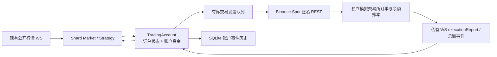

# hquant 第一轮交易链路实施记录

状态：本文记录首轮本机模拟交易所链路与当时的测试数据。可靠恢复、风控与控制的后续实现见[后续开发记录](TRADING_CHAIN_FOLLOWUP.md)。代码使用项目的 C++20 Bazel 配置，保留 v1 Paper 回放兼容。`live` 模式仍由配置校验拒绝；本文的通过结果不代表真实账户可运行。

## 已落地的链路



- `Runtime` 按账户创建 `TradingAccount`。多个 Shard 可引用同一账户；每账户只有一组交易 REST 与私有 WS 连接。共享账户统一检查跨标的资金，待发送订单先预留资金。
- `OrderState` 区分本地排队、交易所确认、部分成交、终结状态与撤单阶段。撤单返回与新单决策之间等待交易所事实；REST 撤单结果可能先于成交回报到达，此时保留待确认与资金占用。
- Paper 撮合器移动到 `sim/`，通过 `TradePort` 向同一账户状态机报告事件。v1 的既有 Paper 回放仍可使用。
- `venue/binance/` 发送签名限价单、撤单、订单查询，订阅并解析 Binance Spot 私有 WS 的订单和余额事件。`external_sim` 仅允许本机端点；模拟器用独立 socket 与账本产生接受、拒绝、部分成交、完全成交、撤单、撤单中成交及重复私有回报。
- Control `status` 增加账户余额、可用额、预留额、活动与未知订单、队列深度和错误；停机时保留最终账户快照用于压测三方核对。

当前核心目录：

```text
hquant/
  src/
    config.*  runtime.*  control_server.*  sqlite_history.*  main.cc  perf_probe.h
    base/ids.h  base/net.*
    shard/shard.*  shard/market.*  shard/binance_feed.*  shard/strategy.*
    trading/trading_event.h  trading/trade_port.h
    trading/order_state.*  trading/funds_state.*  trading/trading_account.*
    sim/paper_exchange.*  sim/paper_trade_port.*
    venue/binance/auth.*  venue/binance/trade_client.*  venue/binance/user_stream.*
  bench/venue/mock_binance_server.py  bench/trade_chain_bench.py
  bench/validate_trade_chain.py
  test/order_state_test.cc  test/funds_state_test.cc  test/trading_account_test.cc
  test/binance_auth_test.cc
  test/e2e_trade.py  test/run_trade_e2e.cc
```

`paper_exchange.*` 从 `src/shard/` 迁移到 `src/sim/`；`src/` 根目录没有新增交易类。完整前后目录及后续计划见[交易链路设计](TRADING_CHAIN_DESIGN.md)和[开发文档](TRADING_CHAIN_DEVELOPMENT.md)。

## 验收方式与结果

在仓库根目录执行：

```sh
/Users/larry/.local/bin/bazelisk test //hquant/test:end_to_end //hquant/test:trade_end_to_end //hquant/test:binance_auth_test //hquant/test:order_state_test //hquant/test:funds_state_test //hquant/test:trading_account_test --test_output=errors
/Users/larry/.local/bin/bazelisk build --config=release //hquant/src:hquant_server
python3 hquant/bench/trade_chain_bench.py /private/tmp/hquant-market-cases/stress --symbols 1000 --duration-seconds 30 --state-dir /private/tmp/hquant-trade-1000-next
```

六个 Bazel 测试均通过，其中签名测试使用 Binance 官方发布的 Spot 请求样例。最后一次完整运行结果在 `/private/tmp/hquant-trade-1000-04/trade_chain_result.json`，`valid: true`，服务端正常退出且无错误日志。原始公开行情样本未更改。

| 指标 | 实测 |
| --- | ---: |
| 标的 / 行情发送 / 完成通知 | 1000 / 300000 / 300000 |
| 模拟交易所实际挂单 / 撤单 | 3800 / 1725 |
| 成交 / 已应用私有回报 | 3696 / 9437 |
| 明确拒单 / 撤单中成交 / 重复成交回报 | 350 / 246 / 216 |
| 行情发送 → Shard 同步完成 p99 | 56 μs |
| 行情发送 → 模拟交易所收单 p99 | 428 ms；仅统计实际产生命令的样本 |
| 私有回报发送 → 账户应用 p99 | 1.65 ms |
| 交易发送队列等待 p99 | 419 ms |
| socket 写入 / REST 响应等待 p99 | 46 μs / 1.19 ms |

`validate_trade_chain.py` 逐个比较模拟器收单 ID、交易所订单 ID、成交 ID、价格与数量、终态剩余量、每资产余额、最终账户可用与预留金额、SQLite 账户事件连续序号及历史缺口。最终账户为 Ready，队列、活动订单、未知订单均为零，三方核对错误为零。行情到成交的长尾包含订单存活至后续撤单时发生的竞态成交，不能解释成网络发送耗时。

## 尚未完成的实盘能力

- 可靠 `OrderJournal`、重启恢复和 `SyncFromVenue` 尚未实现。当前 SQLite 是观察历史，不保证崩溃后能恢复下单意图。真实账户因此继续禁止启动。
- 私有 WS 断线后会暂停账户，但尚无订阅重建、按原 client ID 查询未决订单与成交、余额全量同步的完整恢复流程。
- 私有事件的官方协议样例夹具、成交与账户余额查询、动态交易规则、请求额度与退避、账户级风险限额、人工暂停／恢复控制，以及故障注入与长时间运行门禁尚未完成。签名 HMAC 已用官方 Spot 请求样例验证。
- 第一轮记录了各交易请求的队列等待和网络阶段分布，尚未输出账户队列与历史队列的完整高水位、拒绝数和每次私有流积压分布。实测交易队列等待主导订单延迟；扩展实盘前应先确定交易端点的请求额度和优先级策略。

下一阶段按[开发文档](TRADING_CHAIN_DEVELOPMENT.md)的 P3–P5 继续，必须先完成可恢复日志与启动同步，再考虑放开 `live` 配置门禁。
