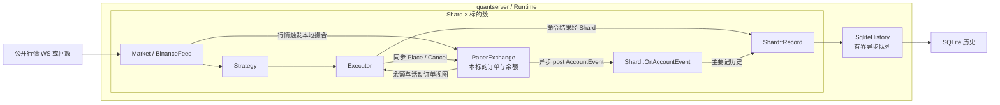
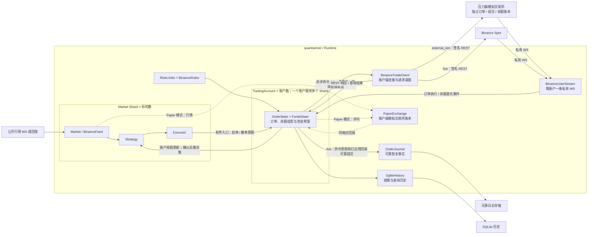

# hquant 完整交易系统设计（提案）

本文设计从原 Paper 系统演进到单交易所、账户级现货交易系统的完整目标。1000 标的、30 秒模拟交易所压测是第一个验收节点，不是最终架构边界。首轮核心链路已经实现并通过该节点，当前代码和实测结果见[实施记录](../development/TRADING_CHAIN_IMPLEMENTATION.md)；可靠恢复、风控与实盘门禁仍属于后续目标。[DESIGN.md](DESIGN.md) 描述的是原 Paper 系统，其中“实盘主要替换 PaperExchange”的设想不适用于共享账户和异步订单回报。

## 1. 现状与目标

### 当前实现

- 一个 Shard 对应一个标的，持有 Market、Strategy、Executor 和 PaperExchange。Executor 直接调用 PaperExchange；订单和余额的权威状态在各自的 PaperExchange 中。
- PaperExchange 发出的 AccountEvent 会异步回到 Shard，但 Shard::OnAccountEvent 主要记录历史，不管理订单生命周期。撤单在 Paper 内同步完成，RunDecisionCycle 因而可以立刻再次决策。
- 配置拒绝 live，也拒绝多个 Shard 共用账户。现有 stress 配置给 1000 个标的分配 1000 个 Paper 账户。
- 现有 1000 标的、30 秒 case 测公开行情与进程内 Paper。UDP 完成通知覆盖行情同步处理，不覆盖外部订单发送或私有回报。SQLite 历史队列满时可以产生缺口。

### 完整目标

一个交易账户管理多个标的的订单、成交、资金和风险。公开行情可以按标的分片；交易命令、私有回报、请求额度和资金检查必须按账户集中处理。Paper、独立模拟交易所和真实 Binance Spot 都遵守相同的本地订单状态与回报规则。实盘还必须在进程重启、网络超时、私有流断线或磁盘故障后保留可核查的订单事实，并在确认账户状态之前阻止新单。

### “私有回报”具体是什么

这里的“私有”指交易账户授权后才能订阅的 User Data Stream，不是公开盘口行情。它传来交易所主动推送的账户事件；“私有回报”是简称，更准确的名称是“账户私有事件”。按 [Binance Spot User Data Streams](https://developers.binance.com/en/docs/products/spot/user-data-stream)，至少需要处理以下三类：

| 事件 | 内容 | 本地处理 |
| --- | --- | --- |
| `executionReport` | 自己的订单接受、拒绝、成交、撤单等状态及成交 ID、数量、手续费 | OrderState 更新订单，FundsState 同步调整该订单的资金占用和实际资产变化 |
| `outboundAccountPosition` | 发生变化的资产的 free、locked 余额 | FundsState 更新交易所报告值；它只列变化资产，不能当作全账户快照覆盖 |
| `balanceUpdate` | 充值、提现或账户间划转等余额变化 | FundsState 记录外部资金变动；无法与本地订单投影解释时暂停新单并查询账户 |

下单 REST 响应是一次请求的响应，私有事件是账户状态变化的异步通知；两者可能先后颠倒。私有流也可能断线或漏报，所以启动、重连和未知结果处理还要查询交易所订单、成交及[账户余额](https://developers.binance.com/en/docs/catalog/core-trading-spot-trading/api/ws-api/account)。

### 首个验收节点：外部链路验证

保留现有 1000 标的、30 秒行情事件，用一个共享测试账户运行。行情仍走公开 WS；挂单、撤单和查询走与 Binance Spot 相同的签名 REST 请求；接受、拒绝、成交、撤单和余额变化走私有 WS。压力器使用独立订单、成交和余额账本，通过真实 socket 与 quantserver 通信。最终逐个 ID、数量、资金和历史序号核对。

第一轮采用明确的 external_sim 模式：运行真实交易客户端，对端只能是本机模拟交易所。live 模式继续拒绝启动，直到可靠恢复、风控和运行门禁通过验收。两种模式使用同一交易协议编解码和订单状态机。目标协议参照 [Binance Spot REST](https://developers.binance.com/en/docs/products/spot/rest-api) 与 [User Data Stream](https://developers.binance.com/en/docs/catalog/core-trading-spot-trading/api/ws-api/user-data-stream)；本机合成标的只用于压力验证，不代表交易所实际可交易标的。

30 秒压测通过只验收外部链路与该负载下的正确性。后续按第 6、8 节验证持久化、断线重启、风险门禁和运行控制，再允许 live。

### 与现有 Hummingbot 实现的对照

参照本机 `hummingbot` 仓库的 Binance Spot 连接器。它提供订单跟踪、私有回报和查询补漏的可核查实现；本方案按当前 C++ 的 Shard、Runtime 和 SQLite 边界重新定义所有权，不直接搬运类结构。

| Hummingbot 参照 | 当前 hquant 缺口 | 本设计落点 |
| --- | --- | --- |
| [InFlightOrder](../../../hummingbot/hummingbot/core/data_type/in_flight_order.py) 保存本地与交易所订单 ID、执行量和状态 | PaperExchange 订单只服务单 Shard，外部发包和回报没有统一订单状态 | OrderState 保存订单投影，FundsState 保存资金预留，TradingAccount 串行协调 |
| [ClientOrderTracker](../../../hummingbot/hummingbot/connector/client_order_tracker.py) 跟踪活动、已结束缓存和丢失订单 | OnAccountEvent 主要写历史，异步撤单没有等待确认的门禁 | TradingAccount 串行处理回报，Shard 在状态确认后再决策 |
| [BinanceExchange](../../../hummingbot/hummingbot/connector/exchange/binance/binance_exchange.py) 分开下单、私有 executionReport、查订单和补查成交 | 目前只有进程内 Paper 调用 | BinanceTradeClient、BinanceUserStream 与 SyncFromVenue 分工，并按成交 ID 去重 |
| [私有流数据源](../../../hummingbot/hummingbot/connector/exchange/binance/binance_api_user_stream_data_source.py) 负责签名订阅及事件解包 | 目前只有公开行情 WS | 每账户一条私有流，断线后停止新单并同步账户状态 |

可靠发送意图、崩溃恢复和账户级风险门禁仍需在 hquant 中明确实现与验证，不能由上述参照代码或第一轮压测自动保证。

### 修改前：每个 Shard 自带 Paper 账户

上图的 `Shard × 标的数` 表示同一组组件重复创建；现有压力配置中 1000 个标的对应 1000 份 Paper 账户状态。订单在进程内同步完成，交易所私有回报、账户级资金汇总和外部交易连接尚不存在。

### 修改后：按账户集中处理订单与资金

实线外部交易路径按账户复用，`external_sim` 与 `live` 运行时只选一个对端；虚线 Paper 路径是另一种运行模式。`OrderJournal`、完整风控及动态规则属于实盘能力节点，第一轮外部链路测试先建立 TradingAccount、交易客户端和独立模拟交易所。账户事件由 TradingAccount 应用后再推送到相关 Shard；入发送队列不会产生 Accepted，未知结果保持预留并触发查询。

## 2. 命名与所有权

`src/` 根目录保留现有的程序入口、配置、Runtime、控制、回放与历史服务，不再放新增交易类。新文件按职责进入三个目录：`trading/` 放交易所无关的订单、资金、账户状态与可靠意图；`venue/binance/` 放 Binance 的交易请求和私有流协议；`sim/` 放账户级 Paper 撮合账本。现有 `shard/` 仍负责单标的行情和策略，`base/` 仍只负责通用类型与网络传输。这样保留当前公开行情 `shard/binance_feed.*` 的位置，避免为整理目录改动行情链路。

| 名称 | 所属状态与职责 |
| --- | --- |
| TradingAccount | 每个交易账户一个。串行处理所有标的的下单意图、订单回报、资金预留和账户视图；它是 quantserver 内订单与资金投影的唯一写入者。 |
| OrderState | 纯订单状态转换与成交去重规则，不负责 socket、数据库或策略。 |
| FundsState | TradingAccount 内的账户级资金状态组件。按资产保存交易所余额、按订单保存本地预留，计算共享可用资金；没有独立线程或网络连接。 |
| TradePort | `trading/trade_port.h` 中的小接口，只表达挂单、撤单和查询；Runtime 注入 Paper 或 Binance 实现。 |
| BinanceTradeClient | 每账户复用的签名 REST 下单、撤单及查询；使用账户级请求调度器，与现有只处理公开行情的 BinanceFeed 区分。 |
| BinanceUserStream | 每账户一个私有回报连接，解析后向 TradingAccount 投递标准化事件。 |
| BinanceAuth | 两条交易通道共用的签名、请求时间及认证字段生成；不放在通用 base/net 中。 |
| PaperExchange | 账户级模拟交易所账本及按标的撮合。它从 `shard/` 移到 `sim/`；继续作为交易所一侧的独立状态，不供策略直接读取余额。 |
| OrderJournal | 可靠保存发包意图、交易所回报和账户状态；成功提交是 live 允许发送命令的前提。 |
| TradingAccount::SyncFromVenue | 查询未决订单、成交和余额，比较后更新本地投影。实现放在 `trading/trading_account_sync.cc` 中，仍属于 TradingAccount。 |

`trading/trading_event.h` 保存跨目录的命令和回报值类型。现有 `Side` 从 `shard/market_type.h`、`LimitOrderRequest` 从 `shard/strategy.h`、`OrderReport`／`Fill`／`BalanceUpdate` 从 `shard/paper_exchange.h` 移到此处；原 Paper 的 `OrderState` 枚举改名 `OrderStatus`，避免与新的订单状态组件同名。`TradePort` 只定义发送与查询操作，Paper 另有按行情撮合入口。OrderJournal 只依赖中立事件记录，不依赖 TradingAccount 的实现。Runtime 组装具体实现；TradingAccount 不包含 Shard、Paper 或 Binance 头文件，交易适配器也不写账户状态。Bazel 依赖以 `trading_event` 为底层类型目标，避免循环依赖。

账户事件的历史也由 TradingAccount 编序和写入；Shard 只接收与本标的有关的账户视图变化，并决定是否重跑策略。这样同一账户跨 1000 个 Shard 的回报有一条明确的账户事件顺序，且不会被多个 Shard 重复记录。

## 3. 改动前目录

以下列出与交易链路有关的当前文件；省略其他文档和基准结果文件。

~~~text
hquant/
  src/
    main.cc
    config.h / config.cc
    runtime.h / runtime.cc
    replay_reader.h / replay_reader.cc
    sqlite_history.h / sqlite_history.cc
    control_server.h / control_server.cc
    perf_probe.h
    BUILD.bazel
    base/
      ids.h
      fixed.h / fixed.cc
      net.h / net.cc
      BUILD.bazel
    shard/
      shard.h / shard.cc
      market_type.h
      market.h / market.cc
      order_book.h / order_book.cc
      binance_feed.h / binance_feed.cc
      strategy.h / strategy.cc
      executor.h / executor.cc
      paper_exchange.h / paper_exchange.cc
      BUILD.bazel
  bench/
    make_market_cases.py
    live_ws_bench.py
    ws_sender.cc
    ack_receiver.cc
  test/
    e2e_replay.py
    run_e2e.cc
    BUILD.bazel
~~~

## 4. 改动后目录

这是完整目标目录。标记：★ 外部链路节点新增；→ 从原位置移动并修改；◇ 实盘能力节点新增。没有标记的文件是已有文件，需要按第 7 节修改或保持现状。`src/` 根目录仍为现有 13 个文件（含 `BUILD.bazel`），本方案不向根目录新增文件。

~~~text
hquant/
  src/
    main.cc
    config.h / config.cc
    runtime.h / runtime.cc
    replay_reader.h / replay_reader.cc
    sqlite_history.h / sqlite_history.cc
    control_server.h / control_server.cc
    perf_probe.h
    BUILD.bazel
    base/
      ids.h
      fixed.h / fixed.cc
      net.h / net.cc
      BUILD.bazel
    shard/
      shard.h / shard.cc
      market_type.h
      market.h / market.cc
      order_book.h / order_book.cc
      binance_feed.h / binance_feed.cc
      strategy.h / strategy.cc
      executor.h / executor.cc
      BUILD.bazel
    trading/
      trading_event.h                  ★ 跨目录命令、订单与资金事件类型
      trade_port.h                     ★ 发送挂单、撤单和查询的小接口
      order_state.h / order_state.cc   ★ 状态转换、成交去重和数量校验
      funds_state.h / funds_state.cc   ★ 按资产余额、按订单预留与共享可用额
      trading_account.h / trading_account.cc
                                       ★ 串行协调订单、资金与命令入口
      order_journal.h / order_journal.cc
                                       ◇ 可靠意图、回报、账户状态
      trading_account_sync.cc         ◇ 启动、断线和定期状态同步
      risk_limits.h / risk_limits.cc  ◇ 账户与标的风险限制
      BUILD.bazel                      ★ 独立的账户状态与接口目标
    venue/
      binance/
        trade_client.h / trade_client.cc
                                       ★ 签名 REST、发送队列、订单查询
        user_stream.h / user_stream.cc ★ 私有 WS、事件解析和连接状态
        auth.h / auth.cc               ★ REST 与私有订阅认证
        request_scheduler.h / request_scheduler.cc
                                       ◇ 请求额度、优先级与退避
        rules.h / rules.cc             ◇ 动态交易规则和费率
        BUILD.bazel                    ★ 交易所协议目标
    sim/
      paper_exchange.h / paper_exchange.cc
                                       → 从 shard/ 移来，改为账户级 Paper 账本
      BUILD.bazel                      ★ Paper 模式目标
  bench/
    make_market_cases.py
    live_ws_bench.py
    mock_binance_server.py             ★ 本机订单 HTTP 与私有 WS 服务
    mock_venue_ledger.py               ★ 压力器独立订单、成交、资金账本
    validate_trade_chain.py            ★ 三方状态与 SQLite 核对
    ws_sender.cc
    ack_receiver.cc
  test/
    e2e_replay.py
    order_state_test.cc                ★ 状态转换、重复成交、撤单竞态
    funds_state_test.cc                ★ 跨标的预留、部分成交与余额乱序
    binance_auth_test.cc               ★ 用协议样例校验签名与编码
    e2e_trade.py                       ★ 真实 socket 的交易链路
    order_journal_test.cc              ◇ 发包边界与崩溃恢复
    trading_recovery_test.cc           ◇ 断线、缺失回报与重复成交
    fault_trade.py                     ◇ 故障注入与长时间运行
    run_e2e.cc
    run_trade_e2e.cc                   ★ 为 e2e_trade.py 注册 Bazel 测试入口
    BUILD.bazel
~~~

`venue/binance/` 的文件名省去重复的 `binance_` 前缀，类名仍为 BinanceTradeClient、BinanceUserStream 等。现有 base/net.h 和 base/net.cc 已支持带方法、请求头与 body 的 HTTP 请求以及 WebSocket 读写，先复用它们。公开行情的 BinanceFeed 仍在 `shard/`，与账户私有流保持分离；OrderBook 无需改造。

## 5. 关键数据与时序

### 配置

配置 schema_version 升为 2：顶层 accounts 定义账户模式、端点和账户级限额；每个 Shard 只引用 account_id，市场交易规则仍属于 Shard。Paper 与 external_sim 使用测试初始余额；live 从交易所取得余额，不能把 YAML 初始余额当权威数据。live 还要求可靠日志路径、凭据引用及风险配置，启动后通过状态同步才能进入 Ready。现有 version 1 Paper 配置继续解析成“每 Shard 一个账户”，保持回放测试可用；version 1 live 继续拒绝。

external_sim 允许压力器的合成标的名，但交易请求和回报字段仍使用目标协议；live 必须根据真实交易所的交易规则与标的列表校验。client_order_id 使用账户标识、进程启动随机段和递增序号组成，并受目标协议长度限制；实盘阶段再由可靠意图记录保证重启后的可追溯性。

目标结构示意如下，省略已有的行情、市场规则和策略字段。压力器填入本机端口，并为共享账户提供全部测试资产余额；实盘凭据使用外部引用，不写入历史。

~~~yaml
schema_version: 2
input: { ... }
accounts:
  - id: stress
    mode: external_sim
    venue: binance_spot
    trading_rest: { host: 127.0.0.1, port: 18080, tls: false }
    private_ws: { host: 127.0.0.1, port: 18081, tls: false }
    initial_balances: { USD: "1000000", "...": "..." }
    hard_limits: { USD: "1000000", "...": "..." }
shards:
  - id: 0
    account_id: stress
    market: { ... }
    strategy: { ... }
~~~

### 下单与撤单

1. Shard 根据最新盘口和缓存的账户视图产生意图，将其放入有界的账户入口队列后返回。Shard 在得到账户处理结果前，对同一轮决策保持本地 pending 标记，避免行情连续到达时重复提交。
2. TradingAccount 在单一执行序列中调用 FundsState 做共享资金检查和预留，生成 client_order_id。只有命令进入有界发送队列，订单才成为 PendingSubmit；队列满则本地拒绝并释放预留。来源 bench_seq 可选，定时器触发时为空。每账户只使用固定的小型 HTTP 保活连接池和一个私有流连接，不随标的数增加交易连接；发送队列为撤单和查询留出容量。
3. BinanceTradeClient 异步发包。REST 响应可补充 exchange_order_id，但本地入队和发包都不能记为交易所接受。私有订单回报或状态查询确认后才更新 Accepted／Rejected。超时标记结果未知，保留资金并查询；不自动重发可能已经生效的命令。
4. 撤单状态与订单成交状态分开记录。PendingCancel 期间不重复撤单、不释放资金；期间仍可收到部分或完全成交。收到撤单确认或查单确认，且 FundsState 已处理相关余额变化后，通知相关 Shard 用最新盘口重新决策。
5. 回报按成交 ID 去重，按累计成交量和剩余量校验。私有回报先于 REST 响应、重复或重连后补发时，必须落到同一个 client_order_id。无法安全归并的回报触发状态查询，并禁止相关账户新单。

Strategy 的刷新时间只在账户接受本地命令后推进；本地拒绝不会让该标的无订单地等待完整刷新周期。

### 账户级资金管理：FundsState

FundsState 是纯状态组件，由 TradingAccount 在同一执行序列中调用。它按资产维护交易所报告的 free、locked、total 及更新时间，按 client_order_id 维护预留资产、金额和订单剩余量，向所有 Shard 提供同一个账户可用额。交易所账本仍在模拟交易所或真实交易所；FundsState 是 quantserver 为安全下单维护的本地投影，不是第二个交易所账本。RiskLimits 负责额度政策，FundsState 负责实际余额与预留，二者不能混作一个类。

挂买单预留报价资产及费用余量，挂卖单预留基础资产；待提交、活动、待撤单和结果未知订单都占用资金。拒单或确认撤单后，FundsState 才释放对应预留；部分成交按剩余订单量更新预留，并按实际成交和手续费资产更新投影。重复回报不能重复扣款或重复释放。充值、提现、划转或账户外手工交易带来的余额变化也必须处理，不能仅从本策略的订单推算账户余额。

已接受订单在交易所的 locked 可能已经反映到 free，不能再从该 free 中减去同一笔订单的全部本地预留。FundsState 区分交易所已反映的锁定与尚未反映的本地预留，从一致的账户快照加上后续事件推导可下单额；与最近确认的交易所 free 比较时取保守值。`executionReport` 形成一次本地预测变动，`outboundAccountPosition` 的 free/locked 是交易所报告的绝对值，只刷新相关资产的报告快照，不能再把同一笔成交累计一次。无法判断某笔锁定是否已反映、余额事件晚到或两边数量不符时继续保留占用，进入 Syncing 或 Paused，并查询订单、成交和账户余额；不能用晚到快照直接覆盖本地预留。

例如账户报告 100 USDT 可用，订单 A 待提交占用 60 USDT，则其他标的最多只能再占用 40。A 接受后若交易所报告 free=40、locked=60，A 的 60 已在交易所余额中体现，不能再次从 40 扣减。请求撤单 A 时仍按占用处理，直到撤单结果和账户余额能够互相解释。

### Paper、线程与回放

Runtime 为每个账户创建一个串行的 TradingAccount 执行序列；1000 个 Market Shard 继续分布在现有行情工作线程上。账户处理不在行情回调里等待网络或 SQLite。PaperExchange 改为账户级，按 symbol 存订单并接收相应 Shard 的行情通知；它输出与私有流相同的标准化订单／成交／余额事件，由 TradingAccount 依次交给 OrderState 和 FundsState 应用。

回放模式需要显式处理完成屏障：一条行情触发的 Paper 撮合、账户状态应用和历史入队完成后，读取器才推进下一条输入。这样保留当前回放的确定性；不能简单地把 Paper 移到另一线程而改变事件顺序。

### 停机

先禁止新单，再停止策略定时器，向账户发送撤单意图；继续接收私有回报与查询结果直到已决或达到停机期限。期限届满的订单保持未知状态并报告，不宣称撤单成功。实盘阶段还需将其可靠保存，以便下次启动查询。

### 可靠写入与崩溃恢复

OrderJournal 是 live 的可靠事实来源，与允许异步排队的 SqliteHistory 分开。它保存账户、标的、client_order_id、交易所订单 ID、命令意图、状态转换、成交 ID、FundsState 预留与余额投影变动，以及已应用的交易所回报。一个账户内的意图和回报各有单调序号；订单与资金状态更新和对应日志事件在同一事务提交。历史查询可以从日志生成投影，不能反过来用可能有缺口的历史恢复订单。

live 下单的顺序固定为：TradingAccount 预留有界发送队列的槽位并完成风险检查 → 生成订单 ID 与本地资金预留 → OrderJournal 提交 PendingSubmit 意图 → 允许 BinanceTradeClient 发包。撤单同样先提交 PendingCancel 意图。日志提交失败则不发新单，释放未提交的本地预留并进入 Paused；网络发送和日志写入均不阻塞行情 Shard。回报应用时，先在日志事务内完成去重、订单状态与资金更新，再向 Shard 发布新视图和写观察历史。

崩溃边界按“可能已发出”处理：日志提交前绝不发送；日志提交后至收到明确交易所结果之间，包括发包前崩溃、已发包但未收到响应、收到响应但本地尚未提交，重启后都先按同一个 client_order_id 查询。不得换一个 ID 盲目重发。“查不到订单”单独一次不足以证明未曾成交，还要核对该订单的成交记录与账户余额；仍有疑问则保持 Unknown 并禁止相关账户新单。成交按交易所成交 ID 去重，重放日志和重新查询不会重复扣款。

### 启动、断线与持续状态同步

TradingAccount 的运行状态为 Starting → Syncing → Ready；故障可转入 Paused 或 Degraded；停机为 Stopping。只有 Ready 且相关标的行情新鲜时允许新单。Paused、Degraded 仍允许撤单与查询；私有流不健康、日志写入失败、状态差异未解释或交易所限流失控时阻止新单。

启动时先读 OrderJournal 恢复 OrderState 和 FundsState 中的未终结订单、余额基线与本地预留，再建立私有流并缓存新事件，然后查询交易所活动订单、日志中未决订单的状态和成交，以及账户余额。将查询结果与缓存事件按订单 ID、成交 ID 归并，比较本地与交易所的活动订单、累计成交和 free/locked/total。查到交易所有而本地日志没有的订单时停止新单并报告，不擅自把它当作本策略订单；本地有而交易所查不到的订单保持待查，直到成交与余额也能解释。全部差异消除后才进入 Ready。

私有流断线时立即离开 Ready。重连成功后执行同一状态同步流程；定期进行轻量核查，未知结果或余额差异则提高查询范围。状态同步不是每条行情上的轮询，也不另建一个 Reconciler 对象。若私有事件入口积压到无法可靠消费，暂停新单并在重连后补查，不能静默丢弃回报。

### 风控、交易所规则与请求额度

Executor 可保留与单市场有关的价格、数量步长和最小金额初检；TradingAccount 在接受命令前做最终的原子检查：可用资金、单笔金额、单标的和全账户敞口、活动订单数、连续拒单数、价格相对新鲜盘口的偏离，以及账户是否 Ready。待提交、活动和结果未知订单都计入资金和敞口。某标的行情过期只阻止该标的新单；私有流、账户资金或日志不可信则阻止整个账户新单。

BinanceRules 从交易所获取并定期更新标的状态、价格和数量过滤器、最小金额及费率；live 不能依赖静态测试配置。成交费用按实际回报的费用资产入账，不假设总从报价资产扣除。BinanceRequestScheduler 为同进程账户共享出口请求权重、下单额度和退避；每个账户的交易客户端保持独立 HTTP 连接与私有流，撤单与查单保留队列容量和请求额度，不能被新单淹没。BinanceAuth 管理签名和时钟偏差，凭据只通过受控外部引用加载，日志与压测输出不得包含密钥。

### 运行控制与可观测性

ControlServer 提供只读账户快照：健康状态、私有流状态、订单状态数量、Unknown 数量、各队列深度、余额、最近同步时间、日志写入状态和差异原因。控制动作分为 pause_new_orders、cancel_all、sync_account_state、resume_trading 和 graceful_stop；每个动作有请求 ID、结果与审计记录。resume_trading 必须重新检查私有流、日志、资金和交易所状态，不能只把布尔开关改回 true。

正常停机等待撤单及查询完成；达到期限后把未决状态持久化并退出为“需要恢复”，下次启动先同步，不能在旧订单未知时立即重新报价。

## 6. 验证计划与验收

### 第一节点：1000 标的、30 秒外部交易链路

原公开行情事件和 bench_seq 保持不变。mock_binance_server.py 以独立 HTTP、WS 端口接收交易命令并发送账户私有事件；请求字段、签名验证、响应字段及私有流订阅与回报封装遵循所选 Binance Spot 协议子集。mock_venue_ledger.py 不复用 quantserver 的 OrderState、FundsState 或 TradingAccount 逻辑。固定脚本覆盖接受、拒绝、部分成交、完全成交、撤单及撤单与成交竞态，也覆盖余额更新晚到和账户外资金变动。

分别记录：行情发送→Shard 处理完、行情发送→模拟交易所收到实际订单、私有事件发送→TradingAccount 应用、触发行情→订单最终确认或成交。订单链路按 client_order_id 关联，仅统计实际产生订单的行情样本；一条行情可以对应零单或多单。30 秒结束后停止行情发送，继续排空回报和必要的查单，再通过 Control 的只读分页账户快照核对模拟账本、OrderState、FundsState 及 SQLite。要求订单／成交 ID、数量、每资产 free/locked/total、订单预留及历史序号一致，队列保持有界，并分别输出各类 QPS 与分段延迟。

### 第二节点：恢复、故障与真实约束

沿用同一订单协议和模拟交易所，增加提交后丢响应、撤单时成交、私有流断线、重复或乱序回报、队列满、请求限流、磁盘写失败、发包前后进程崩溃和重启。每个故障都核对三方账本与 OrderJournal；系统必须暂停不安全的新单，同时保留撤单和查询能力。再按真实交易所可用标的、动态规则和额度运行长时间测试，并用非生产账户做小规模验证。策略盈亏、库存控制和逆向选择单独评估，不由链路压测推断。

## 7. 现有文件的修改范围

| 文件 | 修改点 |
| --- | --- |
| config.h / config.cc | schema v2 的 accounts 与 Shard 引用；v1 Paper 兼容；external_sim 只允许本机模拟端点；live 维持门禁。 |
| runtime.h / runtime.cc | 按账户构建 TradingAccount，并注入 `venue/binance/` 或 `sim/` 的 TradePort 实现；路由 Shard；控制启动、排空与停止顺序。 |
| base/ids.h | 区分 client_order_id、exchange_order_id 与原 Paper 数值 ID。 |
| shard/paper_exchange.h / paper_exchange.cc → sim/paper_exchange.h / paper_exchange.cc | 移动并改为账户级账本；订单与账户事件值类型移到 `trading/trading_event.h`，所有 Shard 通过 TradingAccount 提交 Paper 命令。 |
| shard/executor.h / executor.cc | 只做单市场决策转换和初步校验；移除直接读取 PaperExchange 余额计算 Budget 的路径，改用 TradingAccount 提供的 FundsState 账户视图。 |
| shard/shard.h / shard.cc | 删除同步撤单后立即二次决策；按账户状态变化重跑策略；维护本地 pending 决策门禁。 |
| shard/strategy.h / strategy.cc | `LimitOrderRequest` 移到 `trading/trading_event.h`；账户视图包含待提交和待撤订单；避免重复撤单；报价公式第一轮不改。 |
| shard/market_type.h、market.cc、binance_feed.cc | `Side` 移到 `trading/trading_event.h`；将可选 bench_seq 从输入传到触发策略的通知；定时器决策不填来源序号。 |
| sqlite_history.h / sqlite_history.cc | 增加由 TradingAccount 编序的 account_events 表，记录两个订单 ID、成交 ID、来源序号及命令／回报阶段。保留现有按 Shard 编序的历史表供旧记录读取；第一轮要求账户和 Shard 历史均无缺口。 |
| perf_probe.h / main.cc | 增加账户队列、发包、模拟交易所接收、私有回报应用的分段指标。 |
| bench/make_market_cases.py、live_ws_bench.py | 行情样本不变；生成共享账户配置，启动模拟交易所并执行三方核对。 |
| test/e2e_replay.py、BUILD.bazel | 将 Paper 订单断言迁到新的账户事件表，保持原回放行为；注册 OrderState、FundsState 与 socket 链路测试。 |
| control_server.h / control_server.cc | 第一节点提供账户健康、未决数、订单和余额的只读分页快照；完整目标增加暂停新单、状态同步、恢复和安全停机操作。 |
| BUILD.bazel、shard/BUILD.bazel；新增 trading/BUILD.bazel、venue/binance/BUILD.bazel、sim/BUILD.bazel | 拆出中立事件类型、账户状态、交易所协议与 Paper 目标；更新 include 路径，保证 TradingAccount 不依赖具体交易所或 Shard。 |

## 8. 落地顺序与 live 门禁

| 步骤 | 主要交付 | 通过条件 |
| --- | --- | --- |
| 1. 订单语义与账户归属 | OrderState、FundsState、TradingAccount、账户级 PaperExchange、事件驱动撤单换单 | 现有 Paper 回放继续确定，多个 Shard 共用账户时不会超额下单或重复释放预留 |
| 2. 外部交易链路 | BinanceTradeClient、BinanceUserStream、认证、本机模拟交易所及第一节点压测 | 1000 标的、30 秒完整链路；模拟账本、订单与资金投影和 SQLite 逐项一致 |
| 3. 可靠恢复 | OrderJournal、TradingAccount::SyncFromVenue、启动／断线／重启状态同步 | 意图提交与发包边界明确；崩溃测试无重复下单、无重复成交扣款；未知状态阻止新单 |
| 4. 实盘约束与控制 | RiskLimits、BinanceRules、BinanceRequestScheduler、账户健康与控制动作 | 动态规则、资金／敞口／额度门禁生效；异常时可继续撤单和查单 |
| 5. 环境验证 | 故障注入、长时间运行、非生产账户小规模验证 | 所有状态差异有明确处理结果，停机与恢复可重复执行 |

live 在步骤 3、4 的机制实现且步骤 5 的故障门禁通过后才放开。第一节点不包含崩溃恢复，所以其性能数据不包含发包前可靠落盘成本；完成 OrderJournal 后必须在同一压力 case 中再测一次，报告完整实盘路径的延迟、吞吐和写入成本。
