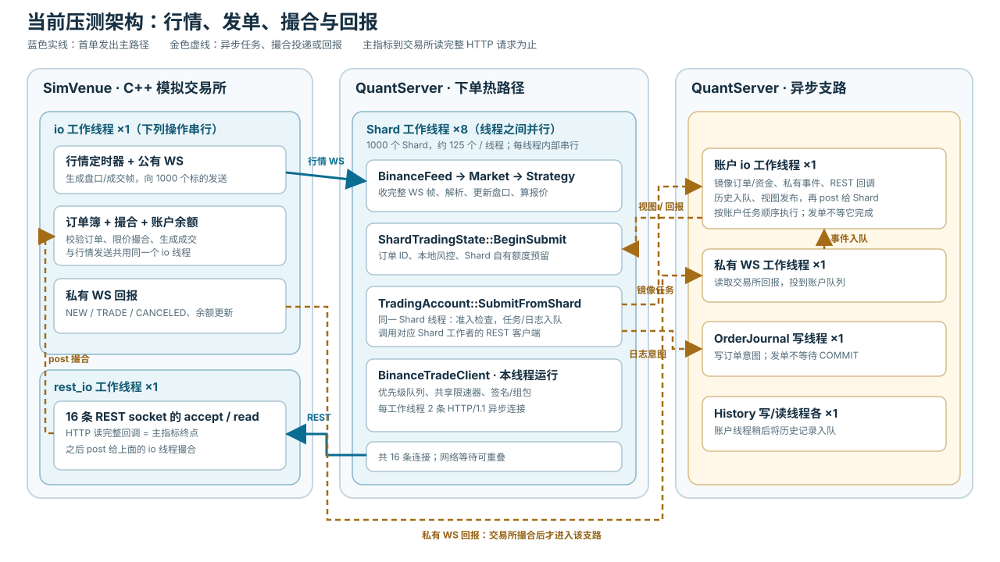

# hquant 发单链路性能问题与优化记录（2026-10-12）

> 状态：记录当前工作区的实现和本机压测；相关代码尚未提交。本文记录**已实施改动**和**实测结论**。主指标到“模拟交易所读完整个下单 HTTP 请求”为止；REST 响应、私有 WS 回报和本地入账另列，不混入发单延迟。

## 1. 目标与口径

目标是让 1000 个标的共享一个账户时，行情触发的订单尽快送达交易所，同时保留每个订单的风控、额度预留、请求限速和故障恢复语义。此前提出的局部目标是账户任务等待低于 10 µs、REST 待发等待低于 20 µs；改为 Shard 本地执行后，前一个“等待账户线程”的阶段已从发单关键路径消失，不能再用移动时间戳宣称达标。

[2026-10-06 旧报告](TEST_REPORT_2026-10-06.html)中的 **34 µs** 是旧 Paper 架构的“行情发送→压测 ACK”p50；进程内 Paper 撮合、无真实 REST 下单，不能与本文“行情发送→交易所读完整请求”或私有回报延迟直接比较。非 Release 二进制与 Release 的性能数字也不作为同一基线比较。

## 2. 当前执行架构：行情到交易所收单

本轮配置：**1000 个标的、1 个账户、8 个 Shard 工作线程、16 条下单 REST 连接**。一个 Shard 负责一个标的；每个工作线程约管 125 个 Shard。本章只跟踪行情触发的**第一笔订单**。主指标在模拟交易所读完整个下单 HTTP 请求时结束。



### 2.1 线程与连接

| 线程 | 连接 | 负责的事 |
| --- | --- | --- |
| QuantServer：Shard 工作线程 ×8 | 每线程约 125 条行情 WS、2 条下单 REST | 收行情、策略、本地风控、写下单请求；8 个线程并行，同一线程的回调依次执行 |
| QuantServer：账户线程 ×1 | 无下单连接 | 从账户队列取任务，更新资金和订单总账 |
| QuantServer：私有 WS 线程 ×1 | 全账户共用 1 条私有 WS | 收订单和成交回报，交给账户线程 |
| QuantServer：数据库线程 | 订单日志写 ×1；历史写 ×1、读 ×1 | 处理 SQLite 队列 |
| SimVenue：`io` 线程 ×1 | 1000 条行情 WS、1 条私有 WS | 发行情、维护订单簿和余额、撮合；这些业务操作串行 |
| SimVenue：`rest_io` 线程 ×1 | 接收 16 条下单 REST | 读 HTTP 请求，读完整后交给 `io` 线程 |

**下单和回报不是同一连接：**下单请求及 HTTP 响应走 REST；`NEW`、`TRADE` 等订单回报走单独的私有 WS。QuantServer 没有专用 REST 工作线程，16 条 REST 连接分在 8 个 Shard 工作线程上。[线程与连接分配](../../hquant/src/runtime.cc)

### 2.2 一笔单怎么发出去

```text
SimVenue/io            改订单簿 → 发这个标的的行情 WS
Shard 所属工作线程      读 WS → 更新 Market → 策略决策 → 本地风控和额度预留
同一个 Shard 工作线程   调 SubmitFromShard：
                       ① 检查账户准入
                       ② 账户镜像任务入队
                       ③ SubmitIntent 入订单日志队列
同一个 Shard 工作线程   REST 队列 → 限速检查 → 签名/组包 → 两条连接之一异步写
SimVenue/rest_io        读完整个 HTTP 请求 ★ 发单延迟终点
```

**没有“Shard → 账户线程 → REST 线程”的发单接力。**从行情解析到 REST 写请求都由所属 Shard 工作线程推进。该线程同步等的是账户镜像任务和 `SubmitIntent` **入队成功**；账户线程执行镜像、SQLite 提交、交易所撮合都不挡住这次写请求。若 REST 两条连接都忙或触发限速，请求在本工作线程的 REST 队列里异步等待，Shard 函数可以先返回。[Shard 决策](../../hquant/src/shard/shard.cc) · [下单入口](../../hquant/src/trading/trading_account.cc) · [REST 队列](../../hquant/src/venue/binance/trade_client.cc)

### 2.3 数据分几份、各自保存什么

| 层级 | 主要数据及含义 | 谁修改、要不要锁 |
| --- | --- | --- |
| **Shard 级：1000 份** | `market_`：本标的盘口；`strategy_`：本标的策略状态；`account_view_`：账户规则和状态发给本 Shard 的副本 | 所属 Shard 工作线程修改，**不用锁** |
| **Shard 级：1000 份** | `trading_.balances_`：分给本 Shard 的资金；`reserved_`/`holds_`：已被本 Shard 订单占用的资金；`orders_`：本 Shard 的订单状态 | 所属 Shard 工作线程修改，**不用锁**。这些资金不是整个账户余额 |
| **工作线程级：8 份** | REST `queues_`：该线程约 125 个 Shard 的待发请求；`rest_lanes_`：该线程的 2 条下单连接 | 只在所属工作线程操作，队列**不用互斥锁** |
| **账户级：1 份** | `funds_`：整个账户的资金总账；`order_manager_`：所有标的的订单总账；`views_`：要发给 Shard 的账户视图 | 账户线程处理；Shard 只投递任务，不直接改。账户处理用 `state_mutex_` |
| **账户级共享入口：1 份** | 准入状态：账户能否下单；`queue_`：Shard、回报送来的账户任务；`journal_sequence_`：账户日志序号 | 8 个 Shard 线程会同时使用；分别用原子变量/`admission_gate_mutex_`、`queue_mutex_`、`journal_mutex_` |
| **进程级：各 1 份** | `RequestScheduler`：全部 REST 连接共用的请求限速计数；`OrderJournal`/`SqliteHistory`：待写数据库队列 | 限速器和数据库队列各用自己的锁 |
| **模拟交易所级：1 份** | `matcher`：各标的买卖盘；`wallet`：模拟余额；`orders`：交易所收到的账户订单 | 只由 `SimVenue/io` 修改；`rest_io` 收到请求后投递给它 |

**发单路径上的结论：**本地盘口、策略、额度、预留和订单状态都在 Shard 内处理，**没有锁**。跨 Shard 的同步只出现在账户准入、账户任务入队、订单日志入队和全局限速；账户总账由账户线程异步更新。[Shard 状态](../../hquant/src/shard/trading_state.h) · [账户状态](../../hquant/src/trading/trading_account.h) · [连接与限速](../../hquant/src/venue/binance/trade_client.cc)

### 2.4 交易所收单和撮合

`SimVenue/rest_io` 的 `http::async_read` **读完整个下单请求**时记录主指标终点，然后把请求投给 `SimVenue/io`。后者才验签、查余额、锁资金，并在这个标的的订单簿撮合。订单簿和模拟钱包都只由 `SimVenue/io` 修改；REST 接收线程不碰它们。[模拟交易所](../../hquant/bench/venue/sim_venue.cc)

例如最优卖价是 **100**：限价 **101** 的买单能成交，成交价取簿上卖单的 **100**；限价 **99** 的买单不能成交，会挂在买盘。相同价位按进入订单簿的先后顺序成交。[撮合代码](../../hquant/bench/venue/matching_engine.cc)

### 2.5 异步支路：账户、日志和回报

账户镜像任务和 `SubmitIntent` 在写 HTTP 请求之前入队。**账户线程**取出镜像任务、更新总账和视图；**订单日志写线程**取出 `SubmitIntent`、写 SQLite。这些执行可能与 REST 网络发送重叠，Shard 只等入队成功。历史记录由账户线程另行放进历史写队列。

交易所的 HTTP 响应沿原 REST 连接返回；`NEW`、`TRADE` 等回报沿**单独的私有 WS** 返回。私有 WS 线程将回报投到账户队列；账户线程先把回报写入订单日志，**提交成功后**才更新账户订单和资金，再把事件投回对应 Shard。交易所撮合、HTTP 响应和私有回报发生在本章主指标终点之后。[账户回报](../../hquant/src/trading/trading_account.cc)

## 3. 完整链路

### 3.1 测试环境和数据

| 项目 | 本轮实际设置 |
| --- | --- |
| 机器与系统 | MacBook Air，Apple M2（4 个性能核、4 个能效核），24 GB 内存；macOS 26.1，arm64 |
| 工具链 | Bazelisk 使用仓库 [.bazelversion](../../.bazelversion) 指定的 Bazel 9.2.0；本机 Apple clang 17.0.0 |
| 编译 | `--config=release`；[.bazelrc](../../.bazelrc) 定义为 `-c opt --copt=-g1`。相关 C++ [编译命令](../../compile_commands.json)含 `-O2 -DNDEBUG -g1 -std=c++20 -fno-omit-frame-pointer`；最低 macOS 版本 13.3。`-g1` 控制调试信息，优化来自 `-O2` |
| CPU 调度 | **未主动请求高优先级 QoS**：`performance_qos_requested=false`，9 个 Quant I/O 工作线程均未执行 `QOS_CLASS_USER_INTERACTIVE` 设置。压测入口没有 `nice`、`taskpolicy` 或绑核设置；外部 shell 的进程优先级未记录 |
| 实时 I/O | **未启用**：`realtime_io_requested=false`。`io_worker_qos_status=0` 是未请求时的默认记录，不能当作提权成功 |
| 压测档位 | 本机 loopback、无 TLS；1000 个固定标的（`STRESSSIM0001`–`STRESSSIM1000`）、1 个账户、8 个 Shard 工作线程、16 条持久 REST 连接；运行 30 秒 |

- **行情：**模拟交易所按固定顺序轮流更新 1000 个标的，每标的计划每 120 ms 做一次“深档挂撤”或“主动扫单”。30 秒产生 **305,000 条计时行情**（250,000 条深度、55,000 条公开成交），平均约 **10,167 条/秒**。Quant 实际处理 318,200 条公开 WS 帧；305,000 个压测 ACK 只确认计时行情已处理。[生成代码](../../hquant/bench/venue/sim_venue.cc) · [实测计数](/private/tmp/hquant-market-socket-trace-20261012/probe.json)
- **交易：**首轮 1000 个标的各下 1 笔买单、1 笔卖单，共 2000 笔；15 秒后 900 个标的刷新，再下 1800 笔。全程共 **3800 次下单、3600 次撤单、400 次账户成交、7800 条私有订单回报**。[账户事件](/private/tmp/hquant-market-socket-trace-20261012/account_trace.csv)
- **延迟样本：**只取首轮每个标的先开始的那笔订单，共 **1000 笔**；起点是触发行情发出，终点是交易所读完整个下单请求。本轮 `valid=true`，本地超时和队列过期均为 0。

### 3.2 链路耗时

各阶段的 p50/p99 分别计算，不能直接相加。

| 层级和时间边界 | p50 | p99 | 样本 |
| --- | ---: | ---: | ---: |
| **1. 行情发送 → Shard 收完整 WS 帧** | **19 µs** | **67 µs** | **1000** |
| └ 行情发送 → Shard 首次 socket 读回调 | 19 µs | 63 µs | 1000 |
| └ 首次 socket 读回调 → 完整 WS 帧 | 1 µs | 9 µs | 1000 |
| 完整 WS 帧 → 行情解析完成 | 4 µs | 28 µs | 1000 |
| **2. 解析完成 → 首单本地准入完成** | **3 µs** | **28 µs** | **1000** |
| └ 解析完成 → 首单开始处理 | 2 µs | 17 µs | 1000 |
| └ 首单开始 → 订单 ID 完成 | 1 µs | 13 µs | 1000 |
| └ ID 完成 → 本地风控与资金预留完成 | 1 µs | 13 µs | 1000 |
| 本地准入完成 → REST 客户端记录 `enqueued_ns` | 2 µs | 35 µs | 1000 |
| **3. REST 入队 → 开始写 HTTP 请求** | **5 µs** | **52 µs** | **1000** |
| └ `enqueued_ns` → 连接派发 | 1 µs | 15 µs | 1000 |
| └ 连接派发 → 开始写 HTTP 请求 | 4 µs | 44 µs | 1000 |
| **4. 开始写 → 交易所读完整 HTTP 请求** | **30 µs** | **106 µs** | **1000** |
| └ 开始写 → 调用 `async_write_some` | 1 µs | 9 µs | 1000 |
| └ `async_write_some` 调用 → 返回 | 5 µs | 30 µs | 1000 |
| └ 写调用返回 → 交易所首次 socket 读回调 | 19 µs | 90 µs | 993 |
| └ 交易所首次 socket 读回调 → HTTP 请求完整 | 1 µs | 15 µs | 1000 |
| **行情发送 → 交易所读完整下单请求** | **74 µs** | **212 µs** | **1000** |

**总耗时按订单相加，再取分位数。** 每笔订单的六段依次是“行情发出→完整帧、完整帧→解析、解析→本地准入、准入→REST 入队、REST 入队→开始写、开始写→交易所读完”。按总耗时排序第 500 笔为 **18+4+3+3+4+42=74 µs**，第 990 笔为 **43+14+45+5+40+65=212 µs**。表中各段的 p50/p99 分别排序，通常来自不同订单，所以横向相加不会得到 74/212 µs。

第 2 段从 `parsed_ns` 算到 `BeginSubmit` 完成后的 `started_ns`；第 3 段从 `enqueued_ns` 算到 `write_start_ns`，均按 1000 笔首单逐笔计算。“写调用返回→交易所首次 socket 读回调”只有 993 笔有序样本；其余 7 笔，交易所读回调先于客户端写调用返回。交易所读完整请求是主指标终点，**不包含撮合、REST 响应、私有 WS 回报或本地入账**。

## 4. 问题、方案和实测结果

以下旧轮次与第 3 章的最新轮次都使用本机 Release、1000 标的、30 秒、16 条 REST 连接；代码版本、探针和首单筛选不同，数值用于定位瓶颈，不能当成严格 A/B 收益。

### 4.1 一个账户线程挡住所有 Shard 下单

**问题：**旧链路是 `Shard 策略 → TrySubmit 入账户队列 → 唯一账户线程 Drain/ProcessSubmit → REST`。账户线程逐笔做风控、资金预留、订单状态、日志/历史和视图工作；来自不同 Shard 的订单也必须排队。早期轮次中，策略请求到该线程开始处理就等了 **80 µs / 1.282 ms**（p50/p99），这段时间还没有做风控；行情发出到交易所读完整请求为 **180 µs / 2.862 ms**。[早期轮次](/tmp/hquant-poolview-final16-20261012.log)

**方案：**创建 Shard 时由 [ResolveShardAllocations](../../hquant/src/config.cc) 分配各自的资金和风险额度；所属 Shard 线程在 [ShardTradingState::BeginSubmit](../../hquant/src/shard/trading_state.cc) 内做风控、订单跟踪和资金预留。之后 [SubmitFromShard](../../hquant/src/trading/trading_account.cc) 检查账户准入，把总账镜像任务和订单意图日志入队，再调用 REST 客户端。账户线程仍更新总账，但下单不等它执行镜像任务。各 Shard 的额度独立，闲置额度不会自动借给其他 Shard。

**结果：**“等待账户线程开始处理”不再位于发单路径，不能把它记作 **0 µs**。最新首单的本地风控与预留为 **1 / 13 µs**，本地准入完成到 REST 客户端记录 `enqueued_ns` 为 **2 / 35 µs**（p50/p99）；后者仍包含准入门禁、两个入队动作等，且时间戳位于 REST 实际队列插入之前。只完成 Shard 本地准入、REST 尚未改造的中间轮次，全链路为 **123 / 269 µs**。[中间轮次](/tmp/hquant-shard-latency-1000-30s-clean.log)；额度拆分和本地准入由 `shard_allocation_test` 覆盖。

### 4.2 唯一 REST 线程让请求再次排队

**问题：**完成 Shard 本地准入后，请求还要投给一个专用 REST 线程。它轮流处理各 Shard 的入队、限速、签名、组包和连接写入；16 条连接可以并行等网络，但这一线程上的准备与派发回调仍依次运行。中间轮次的 REST `enqueued_ns`→连接派发为 **33 / 133 µs**，行情发出→交易所读完整请求为 **123 / 269 µs**（p50/p99）。前一段包含投递、等待唤醒、队列和连接调度，不能全部算作线程等待。[中间轮次](/tmp/hquant-shard-latency-1000-30s-clean.log)

**方案：**[Runtime](../../hquant/src/runtime.cc) 将 16 条 REST 连接分到 8 个 Shard 工作线程，每线程 2 条。[BinanceTradeClient::Enqueue](../../hquant/src/venue/binance/trade_client.cc) 发现当前已在所属线程时直接调用 `QueueOnRest`；只有跨线程调用才走 `asio::dispatch`。请求进入该线程的有界队列，再由本线程检查全局限速、签名组包并异步写连接，不再投给专用 REST 线程。

**结果：**最新首单的 `enqueued_ns`→连接派发为 **1 / 15 µs**，行情发出→交易所读完整请求为 **74 / 212 µs**（p50/p99）。同架构的另外两轮分别测得派发 **1 / 12 µs**、全链路 **90 / 314 µs**，以及派发 **1 / 15 µs**、全链路 **89 / 479 µs**；后一轮带客户端、交易所和 `kevent` 探针。可确认派发耗时降到了微秒级，但全链路 p99 有轮次波动，不能把两次全链路分位数相减当作精确收益。[无新增探针轮次](/tmp/hquant-shard-direct-rest-1000-30s-repeat.log) · [探针轮次](/tmp/hquant-wire-kevent-split-1000-30s.log)

### 4.3 网络写到交易所读取：已定位，未做优化

**问题：**最新首单“开始写→模拟交易所读完整请求”仍为 **30 / 106 µs**（p50/p99），是第 3 章中较长的一段。Binance 参数、签名和 HTTP 组包在 [HttpClient::Send](../../hquant/src/base/net.cc) 记录 `write_start_ns` 之前已经完成，不属于这段时间。

**方案：**在客户端首次 `async_write_some` 调用和返回、[SimVenue](../../hquant/bench/venue/sim_venue.cc) 首次 socket 读回调和 HTTP 请求读完整时分别记录时间戳，按同一订单对齐；本轮只拆分耗时，没有改网络收发逻辑。

**结果：**写调用到返回为 **5 / 30 µs**；写调用返回到交易所首次读回调为 **19 / 90 µs**（993 笔有序样本）；交易所首次读回调到 HTTP 请求完整为 **1 / 15 µs**。另外 7 笔的交易所读回调早于客户端写调用返回，不能硬算这一段。1000 笔均只触发一次交易所底层 socket 读取。最新轮次未启用 `kevent` 探针，现有数据不能再把 19 / 90 µs 分成内核传递与交易所线程调度，也没有可报告的优化收益。

## 5. 验收与复现

### 5.1 实际测试环境

两组正确性测试均于 2026-10-12 在同一台 MacBook Air（Apple M2、24 GB、macOS 26.1、arm64）上执行；Bazel 9.2.0、Apple clang 17.0.0。下表是**四类通道**，不是总共四条 socket。

| 通道 | Quant 用它做什么 | 本机模拟交易所 | Binance Spot Demo |
| --- | --- | --- | --- |
| 公开 REST | `GET /api/v3/depth` 取盘口快照；启动和重同步时用它对齐 WS 增量 | `127.0.0.1` 动态端口，无 TLS | `demo-api.binance.com:443`，TLS |
| 公开 WS | 持续接收 `depthUpdate` 和公开 `trade`；更新盘口并触发策略 | `127.0.0.1` 动态端口，1000 个标的各一条 WS，无 TLS | `demo-stream.binance.com:443`，TLS |
| 交易 REST | 签名下单、撤单，并查询订单、成交和账户余额；HTTP 响应沿请求连接返回 | `127.0.0.1` 动态端口，16 条持久连接，无 TLS | `demo-api.binance.com:443`，TLS |
| 私有 WS | 签名订阅账户用户流；接收 `NEW`、成交、撤单及余额推送，交给账户处理 | `127.0.0.1` 动态端口，账户共用 1 条 WS，无 TLS | `demo-ws-api.binance.com:443`，TLS |

本机另用 UDP ACK 确认计时行情已处理；它不是交易所订单回报。

| 项目 | 本机模拟交易所正确性轮次 | Binance Spot Demo 正确性轮次 |
| --- | --- | --- |
| 进程与模式 | `trade_chain_bench` 内运行 C++ `SimVenue`，启动独立的 C++ `hquant_server`；`pressure_sim` | 本机运行 C++ `hquant_server`，连接远端 Demo；`online_sim` |
| 规模 | 1 个共享账户、1000 个固定标的（`STRESSSIM0001`–`STRESSSIM1000`）、8 个 Shard 工作线程、16 条交易 REST 连接、30 秒 | 1 个账户、1 个 BTCUSDT Shard；每个读写状态目录最多 1 笔限价单 |
| 资金与订单 | 每标的初始 1000 单位及 10 亿 USD，模拟手续费率 0.001 | 入场余额 BTC `0.00019980`、USDT `4983.38227500`、USDC `5000.00000000`；每单 `0.0001 BTC`，策略额度 20 USDT |
| 下单限制 | 未配置请求权重和 10 秒挂单数上限 | 只读 `max_submissions_per_run: 0`；订单验收在新状态目录临时设为 `1`；每分钟 200 权重、每 10 秒 1 次挂单 |
| 盘口与策略 | 900 个普通标的：报价量 1、价差 `0.001`、15 秒刷新；100 个成交标的：报价量 2、价差 `0.00005`、60 秒刷新 | 深度快照 100 档、最多 3 次；未成交单价差 `0.001`、15 秒刷新；成交单买价差 `0`、120 秒刷新 |
| 编译与调度 | `--config=release`（`-O2 -DNDEBUG -g1`）；[探针](/private/tmp/hquant-correctness-20261012-a1/probe.json) 记录 QoS 与实时 I/O 均已请求，9 个 Quant I/O 线程设置返回值均为 0、实时 I/O 验证均为 `true` | 未记录二进制编译参数；这里只验收协议与账本，不报告 Demo 延迟 |
| 结果位置 | `/private/tmp/hquant-correctness-20261012-a1` | 第 5.3 节逐项链接只读、撤单、成交、对账和重启结果；凭据留在权限 `0600` 的本地忽略文件中 |

第 3 章的 **74 / 212 µs** 来自另一轮未请求 QoS 和实时 I/O 的本机性能测试。

### 5.2 本机模拟交易所：验收条件与结果

模拟交易所按固定顺序对 1000 个标的重复深档挂撤和主动扫单。30 秒计划产生 250,000 条计时深度帧和 55,000 条计时公开成交帧；策略首轮对 1000 个标的各报买卖两笔，15 秒后 900 个普通标的刷新报价。压测结束先暂停新单并清场，等账户和私有回报结清后再停止服务。表中前四项是 `valid=true` 的自动验收条件；最后一项是停机后追加的数据库检查。

| 验收项 | 必须满足 | 本轮实测证据 | 判定 |
| --- | --- | --- | --- |
| 行情完整 | 每个 `bench_seq` 有一条已处理 ACK；发送、完整帧、解析、处理、ACK 的时间戳顺序正确；无坏帧 | 305,000 条计时行情对应 305,000 个 ACK，坏帧与 ACK 错误均为 0；加上启动、订单和补单引起的帧，公开 WS 总量 318,200 | 通过 |
| 请求送达 | 首轮 2000 笔下单、刷新 1800 笔下单及 3600 笔撤单按订单 ID 对上客户端与交易所接收记录；无遗留请求 | 下单 3800、撤单 3600；客户端与交易所各记录 7400 条 REST 请求，逐笔关联后没有未匹配请求；首轮报价对应 1000 组买卖单 | 通过 |
| 撮合与私有回报 | 每单仅提交一次、收到一次 `NEW` 和一次终态；成交 ID 唯一、累计成交量不超原单、剩余量等于原单减已成交量；交易所与本地成交逐 ID 对应 | 400 次账户成交；私有回报为 3800 `NEW`、3600 `CANCELED`、200 `PARTIALLY_FILLED`、200 `FILLED`，共 7800 条；无遗留回报或重复成交 | 通过 |
| 账户结清 | 每项资产的 `total/free/locked` 与模拟交易所相同；活动单、未知单、待写日志、本地超时、队列过期均为 0 | 1001 项资产逐项对账；`open_orders=0`、`unknown_orders=0`、`pending_journal=0`，超时与队列过期均为 0 | 通过 |
| 落盘可读 | 历史与可靠日志序号连续、无历史缺口，两份 SQLite 完整 | 停机后另行检查：`history.sqlite` 有 42,003 条连续账户事件、缺口 0；`order_journal.sqlite` 有 41,605 条连续记录；两库 `integrity_check=ok` | 通过 |

撮合单测覆盖撤单幂等、聚合价位及标的隔离；`sim_venue_market_test` 通过真实 WS 和 REST 快照核对公开盘口；`shard_allocation_test` 覆盖额度、预留、部分成交及释放；`trade_chain_smoke`、`trade_end_to_end`、`demo_config_test` 均通过。原始 [行情追踪](/private/tmp/hquant-correctness-20261012-a1/market_trace.csv)、[订单事件](/private/tmp/hquant-correctness-20261012-a1/account_trace.csv)、[客户端 REST](/private/tmp/hquant-correctness-20261012-a1/rest_client_trace.csv)、[交易所 REST](/private/tmp/hquant-correctness-20261012-a1/rest_venue_trace.csv) 和两份 SQLite 均在该状态目录。SQLite 完整性是停机后的追加核对；`valid=true` 由前四项自动断言产生。

复现本机全量轮次时使用新的空状态目录：

```sh
bazelisk --batch build --config=release \
  //hquant/src:hquant_server //hquant/bench:trade_chain_bench
bazelisk --batch test --config=release \
  //hquant/bench/venue:matching_engine_test \
  //hquant/bench/venue:sim_venue_market_test \
  //hquant/test:shard_allocation_test \
  //hquant/test:trade_chain_smoke \
  //hquant/test:trade_end_to_end \
  //hquant/test:demo_config_test
bazel-bin/hquant/bench/trade_chain_bench \
  --symbols 1000 --seconds 30 --rest-connections 16 \
  --server bazel-bin/hquant/src/hquant_server \
  --state-dir /tmp/hquant-trade-perf-new-run
```

### 5.3 Binance Spot Demo：正常交易链路验收

只读、撤单和成交各用新状态目录；成交后用原目录、原余额基线和零下单配置重启。下表按实际发生的链路验收，五项结果均为 `valid=true`。

| 环节 | PASS 条件 | 实测关键证据 | 结果 |
| --- | --- | --- | --- |
| 只读入场 | 规则和全账户余额匹配；公开行情与私有 WS 可用；零下单、零未结订单 | 盘口 `live`，收到 4 条深度、33 条公开成交；活动／未知单 0，下单 0；日志 1712 条连续、两库完整。[结果](/private/tmp/hquant-demo-correctness-20261012-readonly-b/result.json) | **PASS** |
| 未成交单清场撤单 | 单笔订单先收 `NEW`，再收 `CANCELED`；零成交、无未结订单、锁定资金释放 | 订单 `72624963969`：提交 1、撤单 1、成交 0；交易所查单为 `CANCELED`、`myTrades` 为空，余额回到入场值；两库各 1726 条连续记录。[独立核对](/private/tmp/hquant-demo-correctness-20261012-order/independent_check.json) | **PASS** |
| 下单后成交 | 单笔订单收到 `NEW → TRADE/FILLED`；成交只入账一次，数量、价格、手续费正确 | 订单 `72626673505`、成交 `321511253`：买入 `0.00010000 BTC × 82739.22 USDT`，手续费 `0.00000010 BTC`；成交 1、撤单 0，两库各 1725 条连续记录。[结果](/private/tmp/hquant-demo-correctness-20261012-fill/result.json) | **PASS** |
| 独立交易所对账 | 停机后用交易所查单、查成交、查未结订单、查全账户余额，与本地 SQLite 逐项一致 | 4 次签名 GET：订单 `FILLED`、唯一成交 ID 与手续费匹配，未结订单 0；BTC `0.00029970`、USDT `4975.10835300`、USDC `5000.00000000`，锁定额均为 0，其他资产也逐项相等。[独立核对](/private/tmp/hquant-demo-correctness-20261012-fill/independent_check.json) | **PASS** |
| 同目录重启 | 重放日志后余额和订单仍正确；不得再发单或重复入账 | 私有 WS 与盘口恢复；新发单 0，原订单意图和成交各仅 1 条，活动／未知单 0；日志 5149 条连续，历史三次运行 1725／1712／1712 条、无缺口。[重启核对](/private/tmp/hquant-demo-correctness-20261012-fill/restart_check.json) | **PASS** |

**未计入该轮 PASS：**首次 `cancel_all` 控制请求因验收脚本漏传必填字段被拒；表中撤单由服务停机清场完成。该命令已在下方 2026-10-13 单笔采样中复测通过。一次签名 GET 返回 Binance `-1021`，间隔后四项独立查询成功，未增发订单。重启后 `manually paused` 是清场保留的暂停状态，账本对齐。丢 HTTP 响应、私有 WS 断线、限流和第三资产手续费等异常路径尚未在 Demo 复现，见[Demo 验证记录](../operations/BINANCE_DEMO_VALIDATION.md)。

### 5.4 Demo 单笔客户端延迟（2026-10-13）

新状态目录、Release 二进制、BTCUSDT 单笔虚拟资金订单；结果为 `CANCELED`、成交 0，[独立对账](/private/tmp/hquant-demo-latency-20261013-a1/result.json) `valid=true`。以下交易数字均为**单笔观测值**，不能当作 p50/p99；时间戳来自客户端同机 `CLOCK_MONOTONIC`。[完整逐段数据](/private/tmp/hquant-demo-latency-20261013-a1/latency.json)

| 轨道 | 客户端可见边界 | 实测 |
| --- | --- | --- |
| 公开行情 | WS 读取返回→解析完成；每 10 帧采 1 帧，共 12 个样本 | p50 `0.958 µs`、p99 `5.250 µs` |
| 公开行情 | 解析完成→行情事件处理完成（深度更新或公开成交）；同上 12 个样本 | p50 `0.500 µs`、p99 `1.083 µs` |
| 策略与本地准入 | 本次下单的 `Strategy::Decide`；生成订单 ID；本地风控及预留 | `1.375 µs`；`12 µs`；`6 µs` |
| 发单准备 | 本地准入→REST 入队；入队→连接派发；派发→开始写 | `11 µs`；`7 µs`；`46 µs` |
| REST 写请求 | 开始写→请求写完；其中首个 `async_write_some` 调用→返回 | `171 µs`；`51 µs` |
| REST 等响应 | 请求写完→收到完整 HTTP 响应 | `211.827 ms` |
| REST 累计 | REST 入队→完整 HTTP 响应 | `212.051 ms` |
| 下单累计 | 策略生成订单请求→完整 HTTP 响应 | `212.080 ms` |
| 私有 `NEW` | REST 开始写→私有 WS 帧完整；帧完整→解析完成；解析完成→WS 回调结束；帧完整→本地账户应用记录 | `211.906 ms`；`10 µs`；`32 µs`；`692 µs` |
| 回报累计 | 策略生成订单请求→`NEW` 已在本地账户记录 | `212.680 ms` |
| 撤单 REST | 入队→派发；派发→开始写；开始写→写完（首个写调用→返回）；写完→完整 HTTP 响应 | `4 µs`；`31 µs`；`54 µs`（其中 `28 µs`）；`213.535 ms` |
| 私有 `CANCELED` | 撤单 REST 开始写→私有 WS 帧完整；帧完整→解析完成；解析完成→WS 回调结束；帧完整→本地账户应用记录 | `213.547 ms`；`12 µs`；`13 µs`；`828 µs` |

`SubmitFromShard` 从本地准入到函数返回为 `157 µs`，其中与 REST 派发／写入重叠，不能加到上表的累计值。Binance 不提供本轮服务端读完整请求的时间戳；“写完→HTTP 响应”包含网络往返和交易所处理，不能拆成纯网络或撮合耗时。Demo 行情没有 `bench_seq`，无法把某一帧与本单逐帧关联；撤单在观察约 2 秒后才触发，不能用“下单→`CANCELED`”衡量发单速度。本轮没有新增 `FILLED` 延迟样本。

## 6. 本轮代码与数据索引

| 内容 | 位置 |
| --- | --- |
| Shard 额度配置与解析 | [config.h](../../hquant/src/config.h)、[config.cc](../../hquant/src/config.cc) |
| Shard 本地订单/资金准入 | [trading_state.cc](../../hquant/src/shard/trading_state.cc)、[shard.cc](../../hquant/src/shard/shard.cc) |
| Shard 工作线程和 REST 连接分配 | [runtime.cc](../../hquant/src/runtime.cc) |
| 账户镜像、日志和发单入口 | [trading_account.cc](../../hquant/src/trading/trading_account.cc)、[trading_account_journal.cc](../../hquant/src/trading/trading_account_journal.cc) |
| REST 队列、限速、签名、网络写探针 | [trade_client.cc](../../hquant/src/venue/binance/trade_client.cc)、[net.cc](../../hquant/src/base/net.cc) |
| 模拟交易所读探针和完整请求边界 | [sim_venue.cc](../../hquant/bench/venue/sim_venue.cc)、[trade_chain_bench.cc](../../hquant/bench/trade_chain_bench.cc) |
| 旧架构和早期性能报告 | [V2 设计](../architecture/TRADING_CHAIN_DESIGN_V2.md)、[首轮优化计划](TRADE_PATH_POOL_AND_VIEW_PLAN.md)、[旧 Paper 报告](TEST_REPORT_2026-10-06.html) |

