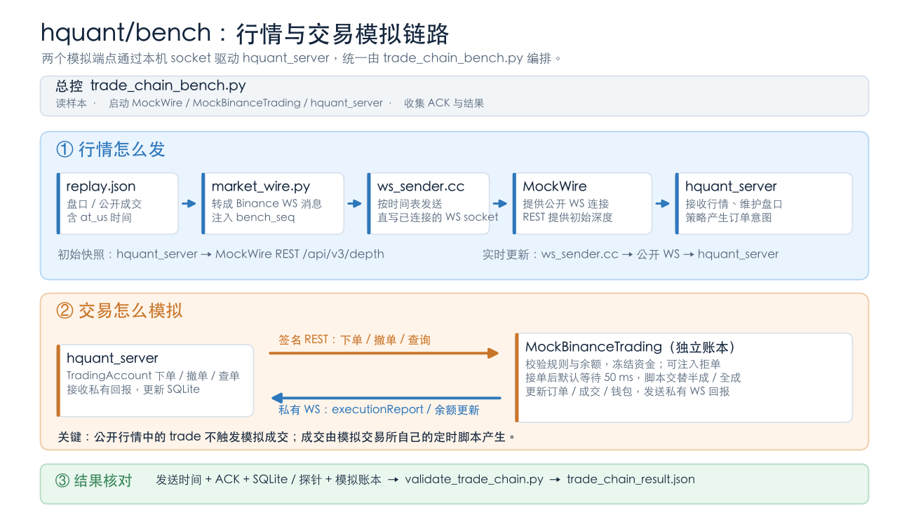

# Bench 目录

`hquant/bench` 通过本机 socket 同时驱动公开行情输入和模拟交易所，对被测的
`//hquant/src:hquant_server` 做链路压测。



| 目录 | 职责 |
| --- | --- |
| `market/` | 旧版行情样本生成与校验工具。 |
| `venue/` | C++ 撮合、公开行情 REST/WS、签名交易 REST、私有 WS 和独立资金账本。 |
| `timing/` | 旧版计时探针。 |
| 根目录 | C++ 压测入口、ACK 接收、SQLite 与最终余额核对。 |

构建服务和压测器，使用全新的空状态目录运行交易链路压测：

```sh
bazelisk --batch build --config=release //hquant/src:hquant_server //hquant/bench:trade_chain_bench
bazel-bin/hquant/bench/trade_chain_bench \
  --symbols 1000 --seconds 30 --rest-connections 16 \
  --state-dir /private/tmp/hquant-trade-run
```

压测入口在同一 C++ 进程运行模拟交易所并生成 `config.yaml`，然后启动
`hquant_server`。状态目录保存 `history.sqlite`、`probe.json`、
`market_trace.csv`、`account_trace.csv`、`account_submit_trace.csv`、
`shared_view_flush_trace.csv`、`rest_client_trace.csv`、
`rest_venue_trace.csv`、`private_venue_trace.csv`、`private_client_trace.csv`
和服务日志。账户任务 trace 记录策略提交账户任务及账户线程开始处理的时间；
共享视图 trace 保留用于排查全账户批量发布；改为 Shard 主动读取共享资金快照后，正常压测中该文件只有表头；
REST 两份 trace 按订单号关联：记录 quant 将请求放入 REST 队列、
REST 出队、调用 REST socket 写入前，以及模拟交易所读完整个 HTTP 请求四个时点。
主要延迟从入队到交易所收完整请求，另打印写入到收包的网络段；交易所处理和任何返回都不计入。
对有行情序号的下单，还按同一订单拆出行情收包、解析、策略与市场处理、账户任务等待、账户处理和 REST 队列等待。
私有回报的两份 trace 用订单号与状态
关联，记录交易所开始写与写完成、客户端开始读、首批 TCP 字节、WebSocket 完帧、解析和
账户回调返回的单调时钟时间戳；客户端逐条采样在内存中，结束后一次写盘。
WebSocket 完帧时间取在 Beast 读完整条消息后、JSON 解析前，作为客户端收包终点。
压测结束时用 Quill 日志优先打印 quant REST 入队到交易所完整收包的下单、撤单延迟。
另外打印行情发出到交易所收单、交易所开始写私有回报到
客户端 WebSocket 完帧，以及完帧到本地入账；完整链路也保留。私有 WebSocket
使用独立 IO 线程读帧，事件按原顺序进入账户任务队列。
正常压测无需 Python。
`--rest-connections` 设置同一账户同时可用的 REST keep-alive 连接数，本地 C++ 压测默认 16；
如需与旧结果对照，显式指定 `--rest-connections 4`。
可设 1..32；所有连接仍共用账户请求限速器。真实 Demo 模式固定为一条连接。
交易所的订单和外部订单共用逐价逐笔撮合；公开成交、深度更新、私有回报及
资金变化来自同一撮合结果。结束时核对行情 ACK、成交／回报数量和各资产余额。
行情延迟同时打印发送到 ACK 接收（T0→T9）及 WebSocket 完帧到服务端处理完成
（T3→T6），便于对照 `docs/TEST_REPORT_2026-10-06.html`。当前 T0 在 C++
模拟交易所调用 `async_write` 前；旧报告的 T0 在原生 TCP `send` 前。

Python 样本生成器与旧版交易链路脚本保留供历史结果复现；新入口直接在 C++
中按计划生成外部挂单、撤单和可扫过下一档的主动订单。
